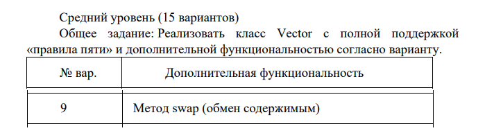
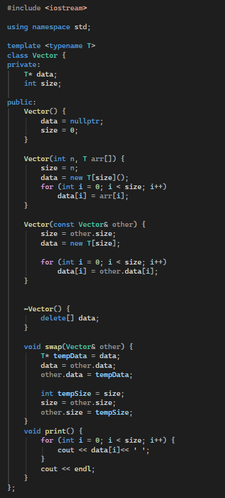
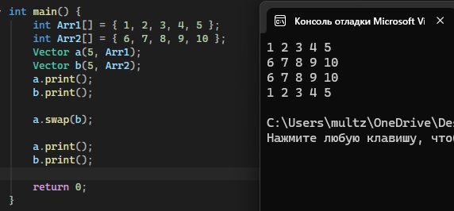

https://github.com/NXGHTMXRE007/alg3

# Лабораторная работа №3

**Студент:** Евдокимов Иван Александрович
**Группа:** ПИЖ-б-о-25-2(1)
**Вариант:** 9

## Цель работы:
1. Реализовать шаблонный класс Vector<T> - аналог std::vector - с нуля  
2. Освоить управление динамической памятью: выделение, расширение, освобождение  
3. Закрепить «правило трёх» (деструктор, конструктор копирования, оператор присваивания) и освоить «правило пяти» (конструктор и оператор перемещения)  
4. Реализовать итераторы для поддержки range-based for и STLсовместимости  
5. Провести амортизированный анализ операции push_back  

## Выполнение практического  задания

Контрольные вопросы
1. Почему динамический массив называется «динамическим»?  
Ответ: Потому что его размер может изменяться во время выполнения программы.  

2. Что такое ёмкость (capacity) и чем она отличается от размера (size)?  
Ответ: size — количество элементов, capacity — количество элементов, для которых выделена память.  

3. Почему при расширении массива ёмкость удваивается, а не увеличивается на фиксированное число?  
Ответ: Чтобы реже выделять новую память и копировать элементы.  

4. Какова амортизированная сложность операции push_back? Почему?  
Ответ: \(O(1)\), потому что расширение массива происходит редко, и затраты распределяются между многими добавлениями.  

5. Что такое «правило трёх»? Когда оно применяется?  
Ответ: Если классу нужны деструктор, конструктор копирования или оператор копирующего присваивания, обычно нужны все три.  Применяется при ручном управлении ресурсами.  

6. Что такое «правило пяти»? Чем оно отличается от «правила трёх»?  
Ответ: Правило пяти включает правило трёх и добавляет перемещающий конструктор и перемещающий оператор присваивания.  

7. В чём разница между конструктором копирования и оператором присваивания?  
Ответ: Конструктор копирования создаёт новый объект на основе существующего. Оператор присваивания копирует данные в уже созданный объект.  

8. Зачем нужна проверка if (this != &other) в операторе присваивания?  
Ответ: Чтобы избежать самоприсваивания объекта самому себе.  

9. Что такое итератор? Как он связан с указателем?  
Ответ: Итератор — объект для перемещения по элементам контейнера. Указатель является простейшим видом итератора.  

10. Зачем нужны методы begin() и end()?  
Ответ: begin() возвращает итератор на первый элемент, end() — на позицию после последнего.  

11. Как реализовать range-based for для своего контейнера?  
Ответ: Нужно реализовать методы begin() и end(), возвращающие итераторы.  

12. Что такое «глубокое копирование»? Чем оно отличается от «поверхностного»?  
Ответ: Глубокое копирование создаёт отдельную память и копирует данные. Поверхностное копирует только указатель на ту же память.  

13. Что такое семантика перемещения и зачем она нужна?  
Ответ: Это передача ресурсов от одного объекта другому без копирования данных. Она повышает производительность.  

14. Почему конструктор перемещения помечается noexcept?  
Ответ: Чтобы гарантировать отсутствие исключений и позволить стандартным контейнерам безопасно использовать перемещение.  

15. Как правильно освобождать память в деструкторе?  
Ответ: Если память выделялась через new[], её нужно освобождать через delete[].  
